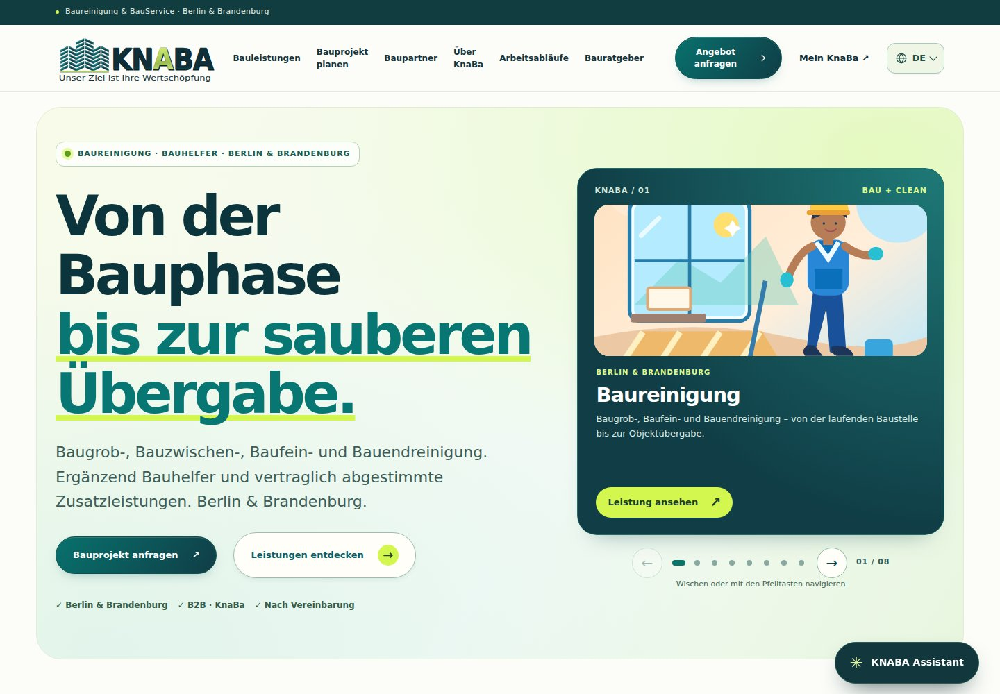
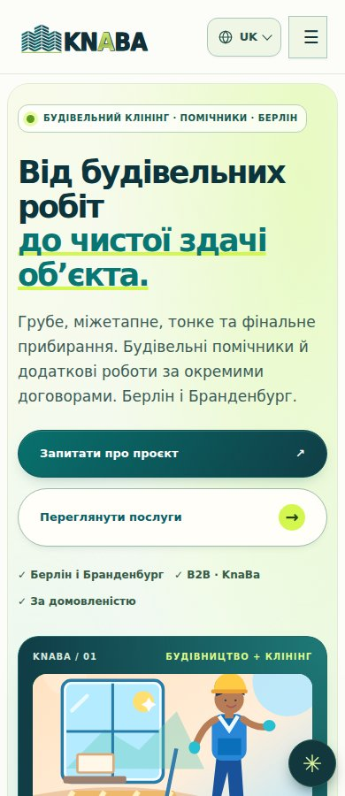

# KnaBa: яскравий публічний дизайн і зручність

> Історичний receipt першого feature-коміту на130сторінок. **Поточний фінальний кандидат із134сторінками та збереженим мобільним розділом: [forward-mobile/QA_UK.md](forward-mobile/QA_UK.md).**

## Результат

Реалізовано додаткове оформлення наявного публічного сайту: насичений бірюзовий, лаймовий, персиковий і бузковий акценти, виразний перший екран, узгоджені картки послуг, контрастні дії та короткі анімації нижче першого екрана. Мобільне меню прокручується на низькому екрані; карусель має більші індикатори та видимий лічильник. Наявні тексти, розділи, посилання, ілюстрації та функціональні контракти збережені.

Це перевірений source-кандидат для staging. Публічний сервер, `main`, офіційний домен і дані замовника цим feature не змінювалися.

## Точна вихідна точка

- Початковий дизайн-baseline: `9127b1d3424517ea061df2eea2ecc820a6bcfbde`.
- Узгоджений останній staging parent: `e2ab9b1883bcac8559dd34939d75bb3e9676dd69`. Паралельне виправлення native form origins / CSRF збережено fast-forward.
- Перевірений feature commit: **`103e3f9feb58aeec7323ae7c4fa5f4cf011355fa`**.
- Git tree: `c7379b2eada21a51fa96b34ab09d43be4919688b`.
- Client artifact SHA256: **`3b5449e1a972afcf4d22d51789553b28b2c1964d9e5cb23ffaf94f10dced42c0`**.
- Node **24.22.1**, незмінений lockfile, `KNABA_RELEASE_MODE=vsp`.

Фінальні перевірки нижче повторено на чистій копії саме цього збереженого feature-коміту. Наступний коміт лише додає цей звіт, результати та скриншоти; runtime, конфігурація й тести залишаються ідентичними. SHA256 кожного feature-файлу наведено в `source.json`.

## Перевірки на точному feature-коміті

| Перевірка | Результат | Доказ |
| --- | --- | --- |
| Astro / TypeScript / Vue / Svelte | PASS, 306 файлів, 0 errors / 0 warnings; 6 наявних hints | `check.log` |
| Vitest | PASS, 287 / 287, 43 test files | `website-tests.log` |
| Native Node website suites | PASS, 32 + 27 + 10 + 8 = 77 | `website-tests.log` |
| Root source/release regressions | PASS, 25 / 25 | `root-tests.log` |
| VPS / SQLite regressions | PASS, 90 / 90 | `vps-tests.log` |
| Історичний import anchor і clean source | PASS, чинний коміт розпізнаний як FEATURE CHANGE | `snapshot-source.log` |
| Staging build / HTML / links / budgets | PASS, 130 HTML; staging noindex збережено | `build.log`, `build-verification.log`, `../../build-verification.json` |
| I18n source | PASS, 28 DE routes / 1053 units; 99 target / 4 published / 95 pending | `build-verification.log` |
| Бренд DE/EN/UK/RU, 320/390/768/1440 px | PASS, 16 / 16 Chromium scenarios | `logo-browser.log` |
| Публічний UI / доступність / motion | PASS, 43 / 43 Chromium scenarios | `browser.json`, `public-browser.log` |
| Збереження вмісту | PASS, 130 / 130 routes, текст і contract attrs однакові, 1 tel link / page | `content-preservation.json` |
| Незалежний source і visual review | PASS, конкретних blockers не залишилося | Опис нижче |

Браузер: офіційний Chromium Headless Shell **151.0.7922.34**, стандартний Playwright launcher і штатний `runBrowserGate`. Локальний HTTP origin: `http://127.0.0.1:18770`. Політики браузера та захисні параметри не змінювалися. Тестові сценарії не надсилали форми і не зверталися до зовнішніх сайтів.

### Що охоплюють 43 UI-сценарії

- Головна DE/EN/UK/RU на 320, 390, 700, 768, 1440 px: без горизонтального прокручування та обрізаних заголовків.
- Каталог, деталь послуги й контактна сторінка чотирма мовами на 700 px.
- Меню на 390×320 px: доступне прокручування, keyboard open, Escape, повернення фокуса.
- Вісім індикаторів каруселі: щонайменше 24×44 px, на телефоні 26×44 px; стрілки, Home, ArrowRight, контрастний фокус на темному першому слайді.
- Reduced motion, українська сторінка при 200% root text, доступність юридичних посилань поруч із кнопкою Assistant.
- Контент, меню і контактний fallback без JavaScript.
- Реальний виклик Web Animations API: 420 ms нижче першого екрана; hero нерухомий; повторне прокручування не повторює анімацію тієї самої картки.

Ці viewport і text-scale перевірки не є тестом на фізичних телефонах або повним screen-reader аудитом.

## Збереження вмісту та швидкодія

Порівняння parse5 перевіряє нормалізовані текстові вузли та атрибути `href`, `src`, `alt`, `action`, `name`, `type`, `id`, `aria-label`, `aria-labelledby` на всіх 130 сторінках. Службові script/style і hashed stylesheet URLs виключено як очікувані артефакти нової збірки. Жодних відмінностей у перевірених користувацьких контрактах; рівно один клікабельний телефон на кожній сторінці.

| Вимір | Baseline | Оновлення |
| --- | ---: | ---: |
| Публічні CSS assets, gzip | 40 949 B | **39 410 B** |
| Чинний максимальний CSS budget | 40 960 B | **40 960 B**, незмінений |
| JS-файли, підключені головною, gzip | 8 480 B | **8 480 B** |

Публічні CSS стали на **1 539 B (3,76%)** меншими. Модуль анімацій вбудований у HTML, тому незмінний розмір окремих JS-файлів не означає відсутності додаткового JavaScript. Детальні розміри HTML, CSS і JS та метод gzip наведені в `content-preservation.json`. Тимчасові копії compiler assets у baseline не включено в метрику публічних CSS. Чинна перевірка всіх assets кандидата проходить без виключень і без підняття лімітів.

Історичний `global.css` збережено. Оптимізація використовує лише обмежений список старих невикористаних класів; scan runtime-джерел, TypeScript AST для динамічних class expressions і окрема перевірка згенерованого HTML захищають чинні класи. Невідоме значення класу чи неповний scan зберігає всі стилі. 14 focused regression cases пройдено у складі Vitest.

Це вимір артефактів, а не field Core Web Vitals чи фактичного мережевого transfer. Нових зовнішніх шрифтів, зображень, animation frameworks або залежностей немає.

## Review та виправлені питання

Незалежний review виявив і закрив: специфічність нової теми відносно scoped Astro CSS, планшетний inset декоративного фону, контраст focus outline на першому слайді, висоту меню на короткому екрані й змішані невідомі class expressions у CSS optimizer. Після виправлення повторені focused тести й реальний браузерний перегляд desktop/mobile пройшли; конкретних залишкових blockers не знайдено.

Початковий browser executable був відсутній; офіційний CDN повертав HTML замість ZIP. Після погодженого встановлення тієї самої офіційної версії з Google Chrome-for-Testing, перевірки provider MD5/SHA256 та ZIP CRC усі фінальні browser-сценарії виконано. Початковий BLOCKED не використовується як PASS.

Один підготовчий VPS-запуск наклався на очищення dist під час build і завершився через відсутні файли. Фінальний 90/90 запуск виконано тільки після завершеної збірки на точному SHA. Після тимчасового скидання робочого середовища код відновлено із вже збереженої GitHub-гілки; усі фінальні логи отримано заново.

## Скриншоти

## Межі, повторення та rollback

Live rollout / owner UAT / physical devices / field Web Vitals: **NOT_RUN у цьому feature**. Автентифіковані ролі й ERP не сертифікуються зміною публічного дизайну. Staging server release потребує чинних source/backup/storage/rollback воріт і окремого дозволу відповідно до AGENTS.

Для повторення: `npm ci`, `npm run check`, `npm test`, `KNABA_RELEASE_MODE=vsp npm run build`, `KNABA_RELEASE_MODE=vsp npm run verify:build`, `npm run test:vps`; root `npm test` і `node scripts/verify-snapshot.mjs`. Після build підняти ізольований loopback preview; задати `KNABA_TEST_URL`, дозволений `KNABA_PLAYWRIGHT_MODULE` і виконати `npm run test:logo:browser`, `node tests/vivid-public-ui-browser.cjs`. При policy block застосувати штатний browser gate, не змінювати захисні політики.

Source rollback — revert feature commit `103e3f9feb58aeec7323ae7c4fa5f4cf011355fa`. Він повертає оформлення до staging parent `e2ab9b1883bcac8559dd34939d75bb3e9676dd69`, зберігаючи його виправлення форм/CSRF. Нових міграцій, змін даних, auth, provider, DNS або платних сервісів feature не містить.
